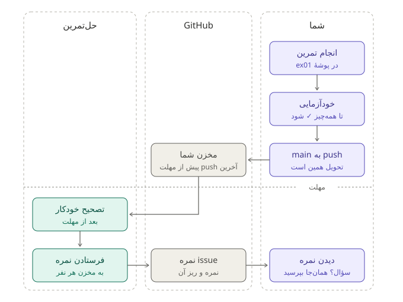

# راهنمای تمرین‌ها

همهٔ تمرین‌های درس یک روال دارند. این صفحه را یک بار، پیش از اولین تمرین، بخوانید.



## یک بار در ترم: آماده شدن

**ابزارها.** این سه باید روی کامپیوترتان نصب باشد: Node.js نسخهٔ ۲۲ یا بالاتر، Git و curl. دستورها را در ترمینال بزنید. در Windows از Git Bash استفاده کنید که همراه Git نصب می‌شود.

**مخزن تحویل.** هر کدام از شما یک مخزن خصوصی در GitHub دارد که همهٔ تمرین‌های ترم را در آن تحویل می‌دهد. این مخزن را خودتان نمی‌سازید:

1. این لینک را باز کنید و با حساب GitHub خودتان وارد شوید: (لینک به‌زودی در کانال درس اعلام می‌شود)
2. اگر GitHub اجازهٔ دسترسی GitHub Classroom را پرسید، قبول کنید.
3. شمارهٔ دانشجویی خودتان را از فهرست انتخاب کنید. دقت کنید شمارهٔ خودتان باشد، چون نمره‌ها با همین شماره ثبت می‌شوند.
4. دکمهٔ Accept را بزنید. چند ثانیه بعد مخزنتان ساخته می‌شود و نشانی‌اش را می‌بینید، چیزی مثل `github.com/ie1405-scu/ie1405-ali-rezaei`.

مخزن خصوصی است: فقط شما، مدرس و حل‌تمرین آن را می‌بینید. لازم نیست کسی را دعوت کنید.

**دو مخزن کنار هم.** مخزن خودتان و مخزن درس را در یک پوشه clone کنید. در دستور اول، نشانی مخزن خودتان را بگذارید:

```sh
git clone https://github.com/ie1405-scu/ie1405-ali-rezaei.git
git clone https://github.com/ie1405-scu/ie1405-scu.github.io.git ie-course-scu
```

حالا دو پوشه کنار هم دارید: مخزن خودتان و `ie-course-scu`. دستورهای تمرین‌ها با همین چیدمان نوشته شده‌اند.

## هر تمرین

1. **فایل‌های تازه را بگیرید.** داخل `ie-course-scu` دستور `git pull` را بزنید تا تمرین تازه بیاید.
2. **پوشهٔ تمرین را بسازید.** پوشهٔ `starter` هر تمرین را با اسم `ex01` (برای تمرین ۱)، `ex02` و … در مخزن خودتان کپی کنید. صورت هر تمرین دستورش را دارد.
3. **کار کنید و خودتان بسنجید.** هر تمرین یک خودآزمایی دارد که نشان می‌دهد کجای کارتان درست است و کجا هنوز ایراد دارد. ابزارها را روی کامپیوتر خودتان اجرا کنید و خروجی همان اجرا را تحویل بدهید. خروجی ساختگی یا کپی‌شده تقلب است.
4. **تحویل بدهید.** کارتان را با `git push` بفرستید. آخرین چیزی که تا مهلت به شاخهٔ `main` مخزنتان رسیده، تحویل شماست. بعد از push، صفحهٔ مخزنتان را در GitHub باز کنید و ببینید فایل‌ها آنجا هستند.

مهلت هر تمرین بالای صورت همان تمرین و در فهرست تمرین‌های سایت درس آمده است.

## نمره

هر تمرین ۱۰ نمره دارد و تست خودکار آن را می‌دهد. بخشی از نمره با تست‌هایی است که از قبل نمی‌بینید.

بعد از تصحیح، یک issue به اسم «نمرهٔ ex01» (یا شمارهٔ همان تمرین) در مخزنتان باز می‌شود و GitHub خبرش را برایتان ایمیل می‌کند. در آن می‌بینید کدام commit تصحیح شده و از هر بخش چند گرفته‌اید. سؤال یا اعتراض را تا یک هفته همان‌جا بنویسید.

## تأخیر

کل ترم ۴ روز تأخیر دارید. اگر برای تمرینی لازمش دارید، قبل از مهلت در مخزن خودتان یک issue به اسم `late ex01` (با شمارهٔ همان تمرین) باز کنید. روزهای تأخیر از روی آخرین push شما حساب می‌شود. چهار روز بعد از مهلت پاسخ تمرین منتشر می‌شود و از آن به بعد تحویلی قبول نمی‌شود.

## هوش مصنوعی

استفاده از هوش مصنوعی آزاد است. فقط در فایل `AI.md` همان تمرین بنویسید از چه ابزاری و برای چه کاری کمک گرفتید. ولی چیزی که نتوانید توضیحش بدهید نمره ندارد: بعد از هر تمرین، با حدود یک‌پنجم دانشجوها به قید قرعه چند دقیقه دربارهٔ کارشان صحبت می‌کنیم.
